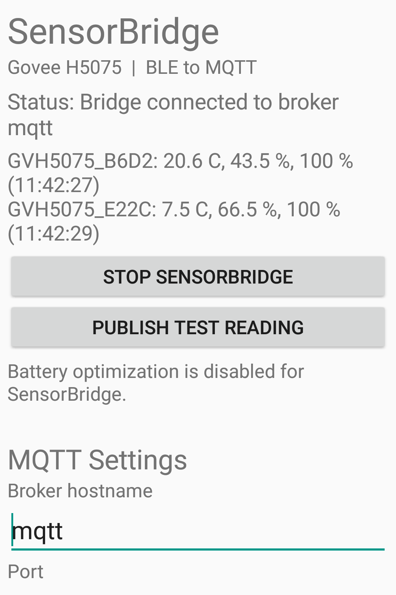
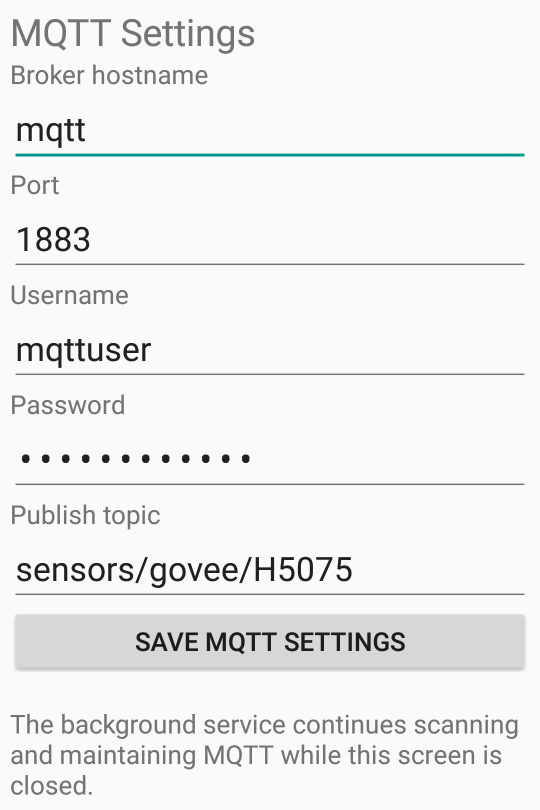
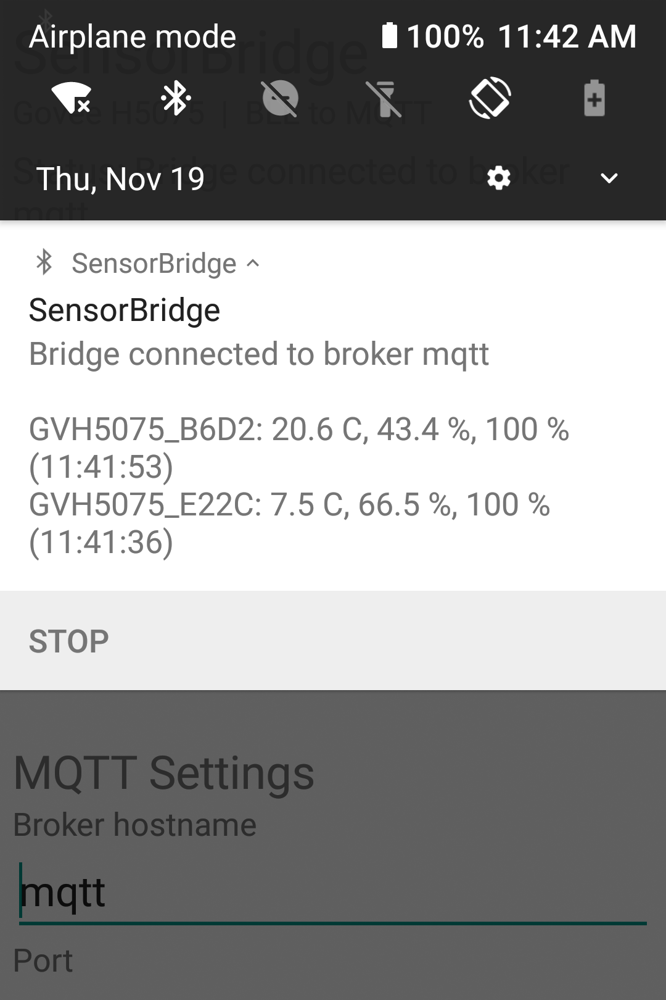
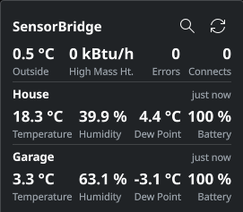

# SensorBridge

An Android app that reads a **Govee H5075** Bluetooth Low Energy thermometer /
hygrometer and forwards every validated reading to an **MQTT** broker.

It runs as a foreground service, so scanning and publishing continue while the
screen is off or the app is closed.

The companion [Plasma widget](plasma-widget/) shows the latest readings on the
desktop, one row per sensor. It reads them from Grafana's HTTP API, so the
usual path is app → MQTT broker → Telegraf → InfluxDB → Grafana → widget. It
can also show an **Outside** row from the IBC boiler collector, which writes a
different measurement to the same bucket.

Only the H5075 format is decoded, but nothing is tied to it: the scan callback
looks up manufacturer ID `0xEC88` and hands the payload to a small class with no
Android dependencies and its own unit tests. Another well-documented BLE sensor
that advertises temperature, humidity and battery normally needs one decoder
modelled on `H5075` plus that lookup; the service, JSON payload and MQTT
handling stay as they are.

<p align="center">
  
  
  
</p>

## How it works

1. `SensorService` scans for BLE advertisements and looks for manufacturer ID
   `0xEC88` (Govee).
2. `H5075` decodes the six-byte payload into temperature, humidity and battery
   level, and rejects error frames and implausible values.
3. Valid readings are published as JSON to the configured topic (QoS 0).
   Each sensor is tracked separately by BLE address, so identical
   advertisements repeated by one sensor within 1.5 s are suppressed without
   hiding readings from another.
4. The MQTT connection is retried every 10 s; a failed publish drops the client
   so the next attempt reconnects cleanly.
5. While running, the service stamps a heartbeat every 10 s. The settings screen
   treats a heartbeat older than 30 s as stopped, so it does not keep showing a
   stale "connected" status after a reboot or an app update.

## Payload

```json
{
  "name": "GVH5075_1234",
  "address": "A4:C1:38:00:00:01",
  "rssi": -62,
  "temperature": 23.5,
  "humidity": 48.2,
  "battery": 95,
  "raw": "01 03 97 DA 5F 00",
  "timestamp": 1700000000000
}
```

`temperature` is Celsius and `timestamp` is milliseconds since the epoch.
`name` is the name the sensor advertises; when an advertisement omits it, the
app falls back to `GVH5075_` plus the last four digits of the address, the same
scheme Govee uses.

## Using the app

1. Install and open **SensorBridge**.
2. Enter the broker hostname, port, username, password and topic, then tap
   **Save MQTT Settings**. Defaults are `mqtt`, `1883`, `mqttuser`, an empty
   password and `sensors/govee/H5075`.
3. Grant the location permission when prompted. Android requires it for BLE
   scanning, and system location must also be switched on.
4. Disable battery optimization when prompted, or tap **Disable Battery
   Optimization**. Otherwise Doze / App Standby can suspend scanning while the
   screen is off. The app shows whether the exemption is currently in place.
5. Tap **START SENSORBRIDGE**. The settings screen and the persistent
   notification show the current state plus one line per detected sensor (for
   example `GVH5075_B6D2: 21.4 C, 48.2 %, 95 %`). Tapping the notification
   reopens the app, and its **Stop** action shuts the service down.
6. Use **Publish Test Reading** to verify the full path to the broker and the
   sensor topic. The test payload uses the reserved name `TEST` and includes
   `"test":true`, so it is easy to filter out downstream.

The service keeps running in the background until **STOP SENSORBRIDGE** is
pressed.

## Download

The signed release APK is attached to the GitHub releases page.

## Plasma widget

`plasma-widget/` is the source directory for the SensorBridge applet
(`com.whatamesss.sensorbridge`).

<p align="center">
  
</p>

From that directory:

```sh
cd plasma-widget
kpackagetool6 --type Plasma/Applet --install .
```

After changing the widget, remove and reinstall it from the same directory:

```sh
cd plasma-widget
kpackagetool6 --type Plasma/Applet --remove com.whatamesss.sensorbridge
kpackagetool6 --type Plasma/Applet --install .
```

The package id is `com.whatamesss.sensorbridge`; `plasma-widget` is only the
source directory. The reinstall removes the placed widget, so add
**SensorBridge** again from the widget chooser and log out and back in to load
the new files. Its settings stay in `~/.config/sensorbridge`.

### How the widget gets its data

The widget reads from **Grafana's `/api/ds/query` API**, not from the app, the
broker or InfluxDB directly. The usual path is:

```
Android app ──MQTT──▶ broker ──▶ Telegraf ──▶ InfluxDB ──▶ Grafana API ──▶ widget
```

- The app publishes one JSON reading per sensor to the configured MQTT topic
  (see *Payload*).
- Telegraf's `mqtt_consumer` input writes each message to InfluxDB, in the
  configured bucket and measurement, with the sensor `name` as a tag.
- Grafana queries that InfluxDB datasource. The widget sends one Flux query to
  Grafana for the newest point per sensor in the last 24 hours and parses the
  returned data frames. A second query reads the newest outside temperature
  point from the boiler measurement in the same bucket, when configured.

Grafana is therefore a required hop, not an optional dashboard. Any pipeline
that ends in the same InfluxDB bucket and measurement works, but the widget
always asks Grafana; it does not subscribe to MQTT, read InfluxDB directly or
scan Bluetooth itself. Other consumers at the broker or database stage
(Node-RED, Home Assistant, a second Telegraf consumer, a different Grafana
datasource) are fine — set *Datasource UID*, *InfluxDB bucket* and *Measurement*
to whatever writes those points.

The widget reads its saved settings from `~/.config/sensorbridge` at launch and
writes changes made in **Configure** back to that file. Double-click the widget
body to open the configured Dashboard URL in a browser; when it is empty, the
Grafana API URL is opened instead. See
[`plasma-widget/README.md`](plasma-widget/README.md) for configuration and
troubleshooting.

## Layout

    android-app/                     Android source, Gradle wrapper, keystore
    android-app/app/src/main/java/com/whatamesss/sensorbridge/
      MainActivity.java              settings UI and service control
      SensorService.java             foreground BLE scanner and MQTT publisher
      H5075.java                     Android-free payload decoder
    android-app/app/src/test/java/com/whatamesss/sensorbridge/
      H5075Test.java                 decoder unit tests
    plasma-widget/                   KDE Plasma 6 desktop widget

## Notes

- The application ID is `com.whatamesss.sensorbridge`.
- The MQTT password is stored in the app's private `SharedPreferences`, which
  is not encrypted. Use a broker account scoped to this device only.
- `REQUEST_IGNORE_BATTERY_OPTIMIZATIONS` is declared so the app can ask to be
  exempted from Doze / App Standby. Google Play restricts that permission to
  exempt app categories, so a store release may need the app to be classified
  accordingly.
