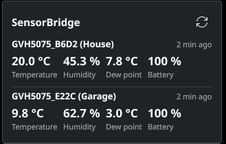

# SensorBridge Plasma widget

A KDE Plasma 6 desktop widget that shows the latest Govee H5075 readings. One
row per sensor, with temperature, humidity, dew point, battery and the age of
the reading.



It is desktop-only: it has no compact panel representation and no applet
tooltip. It always shows the full live view.

The usual path is:

```
Android app ──MQTT──▶ broker ──▶ Telegraf ──▶ InfluxDB ──▶ Grafana API ──▶ widget
```

The widget only talks to Grafana. It queries `/api/ds/query` using the
configured InfluxDB datasource, bucket and measurement, so it does not need
direct access to InfluxDB, the broker, the Android app or a Bluetooth adapter.

## Requirements

- Plasma 6
- Grafana with an InfluxDB v2 datasource (Flux queries)
- A pipeline that writes the readings to that datasource: the usual setup is
  the SensorBridge Android app publishing MQTT and Telegraf's `mqtt_consumer`
  writing them to InfluxDB
- `curl` (proxy handling is configurable in the widget settings)
- A Grafana API token that can query that datasource, unless Grafana allows
  anonymous access

## Direct sources (not implemented)

Only Grafana is supported today. Other sources are possible but need their own
code:

- **InfluxDB v2** — same `curl`/Flux machinery, different endpoint
  (`/api/v2/query`) and an annotated-CSV response. This removes Grafana while
  keeping the broker → Telegraf → InfluxDB pipeline.
- **MQTT broker** — the widget has no MQTT client. It would need a helper such
  as `mosquitto_sub` (and its credentials) or a small local bridge process.
- **BLE from the desktop** — needs a Bluetooth adapter, a scan loop and the
  same payload decoder running on the desktop; only practical when the desktop
  is next to the sensors.

## Install

From this directory (`plasma-widget/`):

```sh
kpackagetool6 --type Plasma/Applet --install .
```

After changing the code, remove and reinstall the applet from this directory:

```sh
kpackagetool6 --type Plasma/Applet --remove com.whatamesss.sensorbridge
kpackagetool6 --type Plasma/Applet --install .
```

The package id is `com.whatamesss.sensorbridge`; `plasma-widget` is only the
source directory. Removing the package also removes the placed widget, so add
**SensorBridge** again from the widget chooser afterwards, and log out and back
in so Plasma Shell loads the new files. Its settings survive in
`~/.config/sensorbridge`.

Remove it with:

```sh
kpackagetool6 --type Plasma/Applet --remove com.whatamesss.sensorbridge
```

Then add **SensorBridge** to the desktop from Plasma's widget chooser.
Double-click the widget body to open the configured Dashboard URL in the default
browser. When no Dashboard URL is set, it opens the Grafana API URL instead.

## Configure

At launch the widget reads its settings from `~/.config/sensorbridge` (or
`$XDG_CONFIG_HOME/sensorbridge`) when that file exists. Those values are also
mirrored into Plasma's applet configuration, so **Configure** shows the
settings actually in use. If the file is missing, the widget falls back to the
configuration Plasma keeps for the applet.

Right-click the widget and choose **Configure** to change the settings. A
change applies immediately and is saved back to `~/.config/sensorbridge`, so it
survives a restart even if the applet is removed and re-added:

| Setting | Default | Notes |
| --- | --- | --- |
| Grafana API URL | `http://grafana:3000` | Base URL that `/api/ds/query` is appended to, including any subpath — **not** a `/public-dashboards/…` link |
| Dashboard URL | empty | Opened on double-click; empty falls back to the Grafana API URL |
| Service account token | empty | Grafana service account token; leave empty only for anonymous Grafana |
| Datasource UID | `influxdb` | UID from the datasource settings page |
| InfluxDB bucket | `sensors` | Bucket fed by Telegraf |
| Measurement | `mqtt_consumer` | Measurement written by Telegraf |
| Sensor names | `GVH5075_B6D2,GVH5075_E22C` | Comma-separated `name` tag values; append `=Label` to override the display label; empty shows all |
| Refresh interval | 60 s | Minimum 10 s |
| Bypass system proxy | on | Turn off to let `curl` use the session's proxy settings |

`Grafana API URL` is the address the widget appends `/api/ds/query` to. If
Grafana serves from a subpath (`serve_from_sub_path=true`), include it, for
example `http://grafana:3000/grafana`. `Dashboard URL` is only used by
double-click and may be a full dashboard page such as
`http://grafana:3000/grafana/d/abc/home`.

To create a token: **Administration → Users and access → Service accounts**,
create an account with the **Viewer** role, then add a token to it.

The token in a `/public-dashboards/<token>` URL is *not* a Grafana API token.
It only authorises the public dashboard's own endpoints; sending it as
`Authorization: Bearer …` to `/api/ds/query` gives `401 Invalid API key`. Put
the API base URL (`http://grafana:3000`) in **Grafana API URL**, not the public
dashboard link. The dashboard link belongs in **Dashboard URL**, if anywhere.
The widget flags both mistakes in its settings.

The token is stored in plain text in the shared settings file (or in
`~/.config/plasma-org.kde.plasma.desktop-appletsrc` when that file is absent).
Use a read-only token scoped to this purpose.

### Shared settings file

Settings that must survive removing and re-adding the applet belong in
`~/.config/sensorbridge`:

```ini
[General]
configured=1
grafanaUrl=http://grafana:3000
dashboardUrl=http://grafana:3000/d/abc/home
apiToken=your-service-account-token
datasourceUid=influxdb
bucket=sensors
measurement=mqtt_consumer
sensors=GVH5075_B6D2=House,GVH5075_E22C=Garage
refreshSeconds=60
bypassProxy=true
```

`configured=1` marks the file as deliberately saved; a file with a recognised
setting is used even without the marker. `dashboardUrl` is optional:
double-clicking the widget opens it when set, otherwise it opens `grafanaUrl`.
Both URLs can also be set in the Configure dialog. Keep the file owner-only
(`chmod 600`) because it holds the token.

The widget only writes this file in response to a **Configure** edit. It is
never rewritten at launch, so a stale file cannot overwrite settings you just
saved. Saving the dialog rewrites the whole file from the effective settings.

## How it works

Every refresh the widget builds one Flux query and runs `curl` through
Plasma's executable data engine. With **Bypass system proxy** on (the default),
the command clears `http_proxy`, `https_proxy`, `all_proxy` (and their uppercase
forms) plus `LD_PRELOAD` (proxychains), and passes `--noproxy '*'`, so the
request goes straight to Grafana. Turn it off to let `curl` use the session's
proxy environment instead.

The query it sends:

```flux
from(bucket: "sensors")
  |> range(start: -24h)
  |> filter(fn: (r) => r._measurement == "mqtt_consumer")
  |> filter(fn: (r) => r._field == "temperature" or ... )
  |> filter(fn: (r) => r.name == "GVH5075_B6D2" or ... )
  |> group(columns: ["name"])
  |> pivot(rowKey: ["_time"], columnKey: ["_field"], valueColumn: "_value")
  |> sort(columns: ["_time"])
  |> tail(n: 1)
```

Configured sensors with no point in the last 24 hours stay visible as
**no data**, so a sensor that stops reporting does not simply disappear. A
reading named `TEST` is ignored.

Known sensor suffixes get a friendly room label by default:
`GVH5075_B6D2 (House)` and `GVH5075_E22C (Garage)`. Append `=Label` in
**Sensor names** to override the label:
`GVH5075_B6D2=Living room, GVH5075_E22C=Shed`. The label is display-only; the
Flux query uses only the part before `=`, so a label never becomes a sensor
name that matches nothing in InfluxDB.

The widget parses Grafana's data frames tolerantly: it accepts the sensor name
from field labels or from a `name` column, and merges frames if the datasource
returns one frame per field.

Dew point is derived from each reading's temperature and humidity with the
Magnus-Tetens formula; it is not a separate InfluxDB field or Grafana query. It
shows as **–** when either value is missing.

## Troubleshooting

- **HTTP 401 / 403** — the token is missing, expired, or lacks permission to
  query the datasource. `Invalid API key` means you pasted a public dashboard
  share token; use a service account token instead. Anonymous requests to a
  Grafana server that requires login also return 401.
- **HTTP 404** — the Grafana API URL is wrong, it includes a subpath that
  `/api/ds/query` is not served under, or the configured Datasource UID does
  not exist.
- **HTTP 400** — Grafana rejected the query. The error from Grafana is shown
  in the widget; check the bucket, measurement, sensor names and that the
  datasource supports Flux.
- **HTTP 5xx** — Grafana (or a reverse proxy in front of it) is temporarily
  unavailable or a backend query failed. The widget retries twice, three
  seconds apart, and shows the server's message or response body so the
  cause is visible if it persists. Grafana itself answers query failures with
  400 or 500, so a **503** means a proxy or ingress answered; the widget
  bypasses the desktop proxy settings, but an older installed copy may still
  be using Qt's HTTP stack. Reinstall the applet (remove it, then install the
  current directory) to pick up the new code.
- **Grafana itself shows no data** — check the datasource health and Grafana's
  logs; the widget depends on that same InfluxDB datasource.
- **Could not reach Grafana** — check the hostname from this machine, whether
  Grafana uses plain HTTP or HTTPS, and that `curl` is installed. The message
  includes curl's own error text.
- **Self-signed HTTPS** — `curl` rejects untrusted certificates. Use HTTP on
  the local network or install the CA in the system trust store.
- **No data for a sensor** — verify the `name` tag in InfluxDB matches the
  configured sensor names, and that the measurement and bucket are correct.
