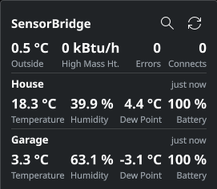

# SensorBridge Plasma widget

A KDE Plasma 6 desktop widget that shows the latest Govee H5075 readings. One
row per sensor, with the value columns described by the configuration
(temperature, humidity, dew point, battery by default), plus an ordered list of
single-value readings (outside temperature, high-mass boiler heat, boiler
errors, Jellyfin connections, …) fed by other measurements in the same InfluxDB
bucket.



It is desktop-only: it has no compact panel representation and no applet
tooltip. It always shows the full live view.

The usual path is:

```
Android app ──MQTT──▶ broker ──▶ Telegraf ──▶ InfluxDB ──▶ Grafana API ──▶ widget
```

The widget only talks to Grafana. It queries `/api/ds/query` using the
configured InfluxDB datasource, bucket and measurement, so it does not need
direct access to InfluxDB, the broker, the Android app or a Bluetooth adapter.

## Requirements

- Plasma 6
- Grafana with an InfluxDB v2 datasource (Flux queries)
- A pipeline that writes the readings to that datasource: the usual setup is
  the SensorBridge Android app publishing MQTT and Telegraf's `mqtt_consumer`
  writing them to InfluxDB
- `curl` (proxy handling is configurable in the widget settings)
- A Grafana API token that can query that datasource, unless Grafana allows
  anonymous access

## Direct sources (not implemented)

Only Grafana is supported today. Other sources are possible but need their own
code:

- **InfluxDB v2** — same `curl`/Flux machinery, different endpoint
  (`/api/v2/query`) and an annotated-CSV response. This removes Grafana while
  keeping the broker → Telegraf → InfluxDB pipeline.
- **MQTT broker** — the widget has no MQTT client. It would need a helper such
  as `mosquitto_sub` (and its credentials) or a small local bridge process.
- **BLE from the desktop** — needs a Bluetooth adapter, a scan loop and the
  same payload decoder running on the desktop; only practical when the desktop
  is next to the sensors.

## Install

From this directory (`plasma-widget/`):

```sh
kpackagetool6 --type Plasma/Applet --install .
```

After changing the code, remove and reinstall the applet from this directory:

```sh
kpackagetool6 --type Plasma/Applet --remove com.whatamesss.sensorbridge
kpackagetool6 --type Plasma/Applet --install .
```

The package id is `com.whatamesss.sensorbridge`; `plasma-widget` is only the
source directory. Removing the package also removes the placed widget, so add
**SensorBridge** again from the widget chooser afterwards, and log out and back
in so Plasma Shell loads the new files. Its settings survive in
`~/.config/sensorbridge`.

Remove it with:

```sh
kpackagetool6 --type Plasma/Applet --remove com.whatamesss.sensorbridge
```

Then add **SensorBridge** to the desktop from Plasma's widget chooser.
Double-click the widget body to open the configured Dashboard URL in the default
browser. When no Dashboard URL is set, it opens the Grafana API URL instead.

## Configure

At launch the widget reads its settings from `~/.config/sensorbridge` (or
`$XDG_CONFIG_HOME/sensorbridge`) when that file exists. Those values are also
mirrored into Plasma's applet configuration, so **Configure** shows the
settings actually in use. If the file is missing, the widget falls back to the
configuration Plasma keeps for the applet.

The shared file is the source of truth for every configurable value. Sensor
names, display labels, formats, colours and the list of extra readings are not
built into the widget; the defaults in `contents/config/main.xml` are empty on
purpose and the widget reads them from the file.

Right-click the widget and choose **Configure** to change the settings. A
change applies immediately and is saved back to `~/.config/sensorbridge`, so it
survives a restart even if the applet is removed and re-added:

| Setting | Default | Notes |
| --- | --- | --- |
| Widget title | applet name | Shown in the header; empty uses the applet title |
| Grafana API URL | empty | Base URL that `/api/ds/query` is appended to, including any subpath — **not** a `/public-dashboards/…` link |
| Dashboard URL | empty | Opened on double-click; empty falls back to the Grafana API URL |
| Service account token | empty | Grafana service account token; leave empty only for anonymous Grafana |
| Datasource UID | empty | UID from the datasource settings page |
| InfluxDB bucket | empty | Bucket fed by Telegraf |
| Measurement | empty | Measurement written by Telegraf |
| Sensor names | empty | Comma-separated `name` tag values; `name=Label` renames one; empty shows every sensor and enables discovery |
| Sensor columns | empty | JSON array; empty shows every numeric field and adds a derived dew point |
| Extra readings | empty | JSON array of single-value readings, in display order |
| Refresh interval | 60 s | Minimum 10 s |
| Bypass system proxy | on | Turn off to let `curl` use the session's proxy settings |

`Grafana API URL` is the address the widget appends `/api/ds/query` to. If
Grafana serves from a subpath (`serve_from_sub_path=true`), include it, for
example `http://grafana:3000/grafana`. `Dashboard URL` is only used by
double-click and may be a full dashboard page such as
`http://grafana:3000/grafana/d/abc/home`.

To create a token: **Administration → Users and access → Service accounts**,
create an account with the **Viewer** role, then add a token to it.

The token in a `/public-dashboards/<token>` URL is *not* a Grafana API token.
It only authorises the public dashboard's own endpoints; sending it as
`Authorization: Bearer …` to `/api/ds/query` gives `401 Invalid API key`. Put
the API base URL (`http://grafana:3000`) in **Grafana API URL**, not the public
dashboard link. The dashboard link belongs in **Dashboard URL**, if anywhere.
The widget flags both mistakes in its settings.

The token is stored in plain text in the shared settings file (or in
`~/.config/plasma-org.kde.plasma.desktop-appletsrc` when that file is absent).
Use a read-only token scoped to this purpose.

### Discovering sensors

Leave **Sensor names** empty and the widget queries every sensor in the bucket.
Press the search button in the widget header (next to Refresh) to do that
explicitly and save the result. Discovery:

- adds every `name` tag value the query returns,
- keeps labels already present as `name=Label`,
- keeps configured names that did not answer, so a sleeping sensor is not
  silently removed, and
- fills **Sensor columns** with the temperature, humidity, battery and other
  fields that have a known display format, preserving any columns and labels
  already configured, and
- ignores metadata such as `time`, `timestamp`, `name`, `address`, `rssi` and
  InfluxDB's `_`-prefixed columns.

Discovery inserts a derived dew-point column directly after humidity when both
temperature and humidity are present. It writes the updated sensor list and
column list to `~/.config/sensorbridge` immediately, so it also survives
removing the widget.

### Shared settings file

All values that must survive removing and re-adding the applet belong in
`~/.config/sensorbridge`:

```ini
[General]
configured=1
title=SensorBridge
grafanaUrl=http://grafana:3000
dashboardUrl=http://grafana:3000/d/abc/home
apiToken=your-service-account-token
datasourceUid=influxdb
bucket=sensors
measurement=mqtt_consumer
sensors=GVH5075_B6D2=Living room,GVH5075_E22C=Shed
sensorFields=[{"field":"temperature","label":"Temperature","format":"temperature"},{"field":"humidity","label":"Humidity","format":"humidity"},{"field":"dewPoint","label":"Dew point","format":"temperature"},{"field":"battery","label":"Battery","format":"battery"}]
extraReadings=[{"label":"Outside","source":"ibc_boiler|boiler=SL10-85G3|outdoor_c","format":"temperature","color":"none"},{"label":"High Mass Ht.","source":"ibc_boiler|boiler=SL10-85G3|load2_btu","format":"kbtu","color":"negative"},{"label":"Errors","source":"ibc_boiler|boiler=SL10-85G3|active_errors","format":"count","color":"negative"},{"label":"Connects","source":"jellyfin_connections|service=jellyfin|value","format":"count","color":"positive"}]
refreshSeconds=60
bypassProxy=true
```

`configured=1` marks the file as deliberately saved; a file with a recognised
setting is used even without the marker. `dashboardUrl` is optional:
double-clicking the widget opens it when set, otherwise it opens `grafanaUrl`.
Both URLs can also be set in the Configure dialog. Keep the file owner-only
(`chmod 600`) because it holds the token.

The widget only writes this file in response to a **Configure** edit or an
explicit discovery. It is never rewritten at launch, so a stale file cannot
overwrite settings you just saved. Saving the dialog rewrites the whole file
from the effective settings.

### Sensor columns

`sensorFields` is a JSON array. Each entry is:

```json
{"field": "temperature", "label": "Temperature",
 "format": "temperature"}
```

- `field` is the InfluxDB field name. `dewPoint` is special: it is derived
  from the `temperature` and `humidity` fields and is not queried.
- `label` is the text under the value.
- `format` is `temperature`, `humidity`, `battery`, `kbtu`, `count` or `raw`.

The known Govee readings are always displayed in the order temperature,
humidity, dew point, battery; unrecognised custom fields follow in their
configured order. Alignment is automatic: the left half of the readings aligns
left, the right half aligns right, and with an odd count the middle reading is
centred. There is no alignment setting.

An empty array means the widget uses every numeric field with a known display
format that the datasource returns, labels them from the field names, and adds
a dew-point column directly after humidity when both temperature and humidity
are present. Metadata fields (`time`, `timestamp`, `name`, `address`, `rssi`
and anything starting with `_`) are never shown as a column. The Discover
action saves the result, so the labels and formats can then be edited in
Configure.

### Extra readings

`extraReadings` is a JSON array in display order. Each entry is:

```json
{"label": "Outside", "source": "ibc_boiler|boiler=SL10-85G3|outdoor_c",
 "format": "temperature", "color": "none"}
```

`source` is `measurement|tag=value|field` in the same bucket; the tag part is
optional (`weather|temp_c`). The tag key must be an identifier. Entries with a
missing field or malformed tag are ignored rather than turning into a broken
query. `format` accepts the same values as sensor columns. `color` is `none`,
`negative` (red while non-zero) or `positive` (green while non-zero). Alignment
follows the same position-based rule as the sensor columns.

### Upgrading from the four fixed readings

Older builds stored `outside`, `boilerHeat`, `jfConnections` and
`boilerErrors`. Those keys are still read and converted to `extraReadings` in
memory, keeping their old labels, formats and colours. The next Configure edit
or discovery writes the new list to the file and drops the legacy keys.

## How it works

Every refresh the widget builds one Flux query and runs `curl` through
Plasma's executable data engine. With **Bypass system proxy** on (the default),
the command clears `http_proxy`, `https_proxy`, `all_proxy` (and their uppercase
forms) plus `LD_PRELOAD` (proxychains), and passes `--noproxy '*'`, so the
request goes straight to Grafana. Turn it off to let `curl` use the session's
proxy environment instead.

With configured sensor columns the query is:

```flux
from(bucket: "sensors")
  |> range(start: -24h)
  |> filter(fn: (r) => r._measurement == "mqtt_consumer")
  |> filter(fn: (r) => r._field == "temperature" or ... )
  |> filter(fn: (r) => r.name == "GVH5075_B6D2" or ... )
  |> group(columns: ["name"])
  |> pivot(rowKey: ["_time"], columnKey: ["_field"], valueColumn: "_value")
  |> sort(columns: ["_time"])
  |> tail(n: 1)
```

With no sensor names and no columns (the discovery query), both filters are
omitted, so every numeric field of every sensor is returned.

Configured sensors with no point in the last 24 hours stay visible as
**no data**, so a sensor that stops reporting does not simply disappear. A
reading named `TEST` is ignored.

The extra readings sit above the sensors. Each one is configured separately and
fetched with its own query (`refId B`, `C`, `D`, … in configured order), which
reads another measurement from the same bucket and takes the newest point of
one field:

```flux
from(bucket: "sensors")
  |> range(start: -24h)
  |> filter(fn: (r) => r._measurement == "ibc_boiler" and r.boiler == "SL10-85G3")
  |> filter(fn: (r) => r._field == "outdoor_c")
  |> sort(columns: ["_time"])
  |> tail(n: 1)
```

Defaults that used to be built in now live in the shared file. For the
collectors under `local-only/` they are:

- **Outside temperature** — `ibc_boiler|boiler=SL10-85G3|outdoor_c` (°C).
- **High-mass heating** — `ibc_boiler|boiler=SL10-85G3|load2_btu`. The value is
  BTU/h and is shown as kBtu/h; it turns red while non-zero.
- **Jellyfin connections** — `jellyfin_connections|service=jellyfin|value`,
  shown as a count and turning green while non-zero.
- **Boiler errors** — `ibc_boiler|boiler=SL10-85G3|active_errors`, shown as a
  count and turning red while non-zero.

An empty list hides the extra readings. A failed extra query does not hide the
sensors; the affected reading simply shows **no data**.

Append `=Label` in **Sensor names** to show a friendly room name:
`GVH5075_B6D2=Living room, GVH5075_E22C=Shed` displays **Living room** and
**Shed**; unlabelled sensors show their raw name. The label is display-only;
the Flux query uses only the part before
`=`, so a label never becomes a sensor name that matches nothing in InfluxDB.

The widget parses Grafana's data frames tolerantly: it accepts the sensor name
from field labels or from a `name` column, and merges frames if the datasource
returns one frame per field. Columns and values are taken from the config (or
from the response when the column list is empty).

Dew point is derived from each reading's temperature and humidity with the
Magnus-Tetens formula; it is not a separate InfluxDB field or Grafana query. It
shows as **–** when either value is missing, or is not shown at all when the
configured column list does not include `dewPoint`.

## Troubleshooting

- **HTTP 401 / 403** — the token is missing, expired, or lacks permission to
  query the datasource. `Invalid API key` means you pasted a public dashboard
  share token; use a service account token instead. Anonymous requests to a
  Grafana server that requires login also return 401.
- **HTTP 404** — the Grafana API URL is wrong, it includes a subpath that
  `/api/ds/query` is not served under, or the configured Datasource UID does
  not exist.
- **HTTP 400** — Grafana rejected the query. The error from Grafana is shown
  in the widget; check the bucket, measurement, sensor names, column fields and
  that the datasource supports Flux.
- **HTTP 5xx** — Grafana (or a reverse proxy in front of it) is temporarily
  unavailable or a backend query failed. The widget retries twice, three
  seconds apart, and shows the server's message or response body so the
  cause is visible if it persists. Grafana itself answers query failures with
  400 or 500, so a **503** means a proxy or ingress answered; the widget
  bypasses the desktop proxy settings, but an older installed copy may still
  be using Qt's HTTP stack. Reinstall the applet (remove it, then install the
  current directory) to pick up the new code.
- **Grafana itself shows no data** — check the datasource health and Grafana's
  logs; the widget depends on that same InfluxDB datasource.
- **Could not reach Grafana** — check the hostname from this machine, whether
  Grafana uses plain HTTP or HTTPS, and that `curl` is installed. The message
  includes curl's own error text.
- **Self-signed HTTPS** — `curl` rejects untrusted certificates. Use HTTP on
  the local network or install the CA in the system trust store.
- **No data for a sensor** — verify the `name` tag in InfluxDB matches the
  configured sensor names (or leave the list empty and press Discover), and
  that the measurement and bucket are correct.
- **A column is missing** — check that `sensorFields` names the InfluxDB field
  exactly, or empty the list to discover the numeric fields. `dewPoint` needs
  the `temperature` and `humidity` fields.
- **An extra reading shows no data** — check its `source` against the
  measurement, tag and field written by the other collector. An invalid entry
  (for example a missing field or a tag key that is not an identifier) hides
  that reading instead of querying.
- **Settings did not survive** — make sure the edit was applied with **OK** or
  **Apply** in Configure, or that Discover ran. The file is deliberately not
  written at launch.
